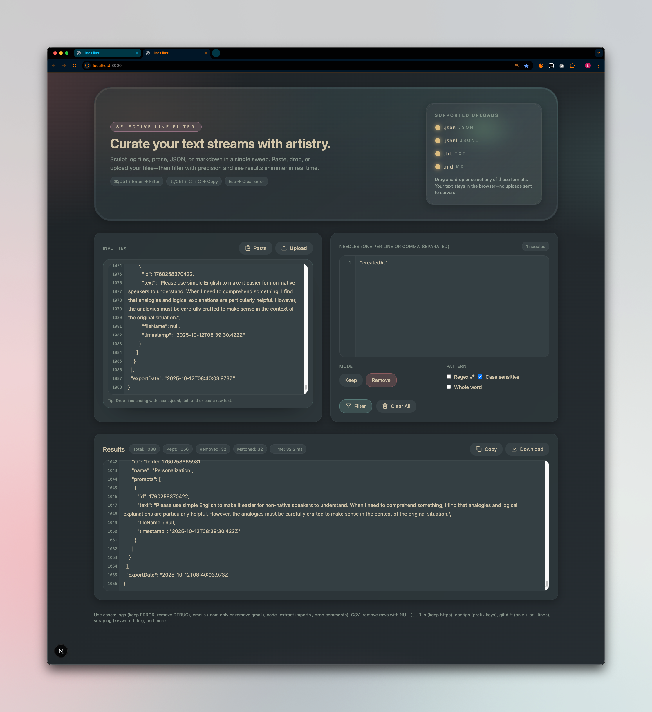

# Line Filter

**Find the lines that matter. Fix repeated text in one pass.**

Clean up logs, lists, and copied text without editing each line by hand. Line Filter keeps or removes matching lines and replaces text throughout a document—all in your browser.

**[Try Line Filter →](https://line-filter.vercel.app/)** · No installation or account needed.

## How to use it

1. **Add your text.** Paste or type into **Input**, or upload/drop a `.txt`, `.json`, `.jsonl`, or `.md` file.
2. **Choose your tool.** Use **Filter** to keep or remove lines, or **Replace** to change text everywhere it appears.
3. **Use the result.** Review and edit **Output**, then copy it or download a text file. Running either tool leaves your input intact.

Start with **Examples**: three ready-to-run examples in each tool. **Undo example** restores your previous draft and output until you edit or switch tools.

## What you can do

### Filter out the noise

- **Keep or remove matching lines.** Isolate warnings and errors, remove comments, or narrow a list to relevant entries.
- **Search for several terms at once.** Separate terms with commas or new lines; a line matches if it contains any term.
- **Control your matches.** Turn on **Match case**, **Whole word**, or **Regex** for more precise searches.

Enter your terms in **Find**, choose **Keep** or **Remove**, then click **Filter lines**.

### Replace repetitive edits

- **Replace every occurrence.** Update URLs, rename a project, or change repeated wording in one pass.
- **Remove unwanted text.** Leave **Replace with** empty to delete matches, such as a repeated `TODO: ` prefix.
- **Match literal text, including multiple lines.** Punctuation and regex characters are treated as ordinary text. **Match case** is on by default; turn it off to match different capitalization.

Fill in **Find** and **Replace with**, then click **Replace all**.

## A workspace that stays out of your way

- **Local processing.** Your text stays in your browser during filtering and replacement.
- **Saved drafts.** Input and settings are saved in this browser when local storage is available. Output and undo history are session-only—copy or download results to keep them.
- **Start fresh anytime.** **Clear all** empties both tools and output and resets matching options, keeping your current tool and theme. A separate **Undo clear** restores your previous draft until your next edit. Clear all stays available while browsing examples.
- **18 Everforest themes.** Mix **Light / Dark**, **Soft / Medium / Hard**, and **Original / Dim / Deep**. Dim and Deep darken the surfaces; your choice is remembered.
- **Keyboard shortcuts.** `⌘/Ctrl + Enter` runs the tool; `⌘/Ctrl + Shift + C` copies output.

**[Open Line Filter and try an example →](https://line-filter.vercel.app/)**
